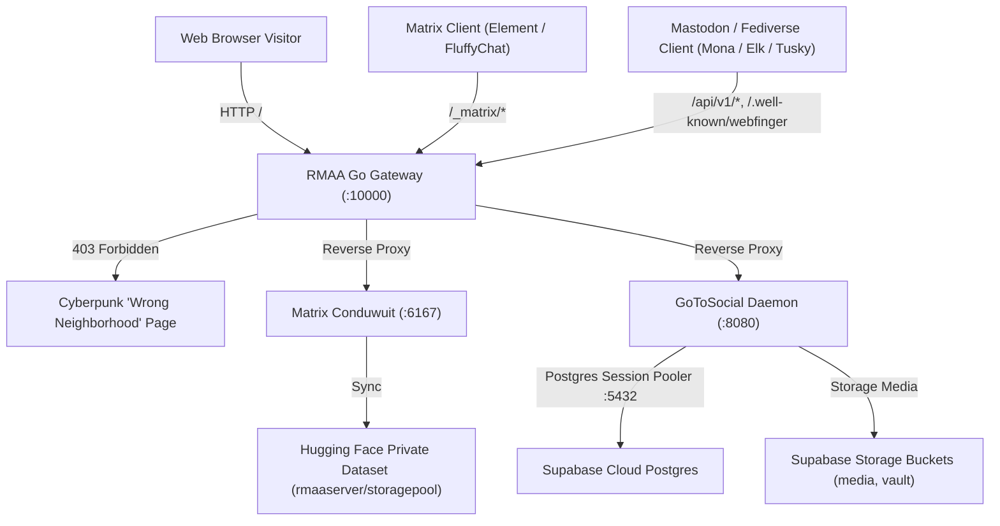

# RMAA Core Server (`s.rmaa.pk`)

Unified, ultra-lightweight private federated communication node for **RMAA HOLDINGS**.

---

## ⚡ Infrastructure & Services Architecture

---

## 🚀 Live Verified Endpoints

- **Domain:** `https://s.rmaa.pk`
- **Matrix Homeserver:** `s.rmaa.pk`
  - Client API: `https://s.rmaa.pk/_matrix/client/versions`
  - User: `@thealidev:s.rmaa.pk`
- **Mastodon / ActivityPub:**
  - Instance API: `https://s.rmaa.pk/api/v1/instance`
  - Webfinger Discovery: `https://s.rmaa.pk/.well-known/webfinger?resource=acct:thealidev@s.rmaa.pk`
  - Fediverse Handle: `@thealidev@s.rmaa.pk`
- **Landing Page:** Returns `403 Forbidden` with the ASCII cyberpunk warning page.
- **Keepalive Heartbeat:** `https://s.rmaa.pk/healthz` (Self-pinging every 10–13.5 min).

---

## 🔐 Credentials & Secrets Reference

- **Admin Account:** `thealidev`
- **Admin Email:** `server@rmaa.pk`
- **Database:** Supabase Postgres Session Pooler (`aws-0-ap-southeast-1.pooler.supabase.com:5432`)
- **Storage:** Hugging Face Private Vault (`rmaaserver/storagepool`) + Supabase S3 Storage (`media`, `vault`)
- **Matrix Recovery Key:** `EsTW WoQZ gdLw SCxn EUmt G7Y8 HESL DTw8 cscB 5pvk qGQL CMf3`
